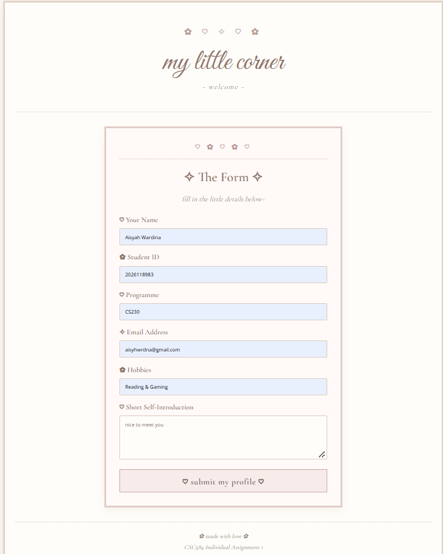
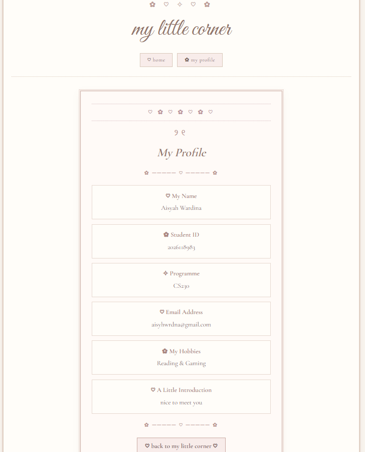

# CSC584 Individual Assignment 1

## Personal Profile Web Application

This project is a simple Personal Profile Web Application
developed for CSC584 Individual Assignment 1.

The application allows users to enter their personal
information through an HTML form and view the submitted
details on a JSP page.

The website uses a vintage scrapbook-inspired design
with cream and pastel colours.

## Technologies Used

- HTML5
- CSS3
- Java Servlet
- JavaServer Pages (JSP)
- Apache Maven
- GlassFish Server 4.1.1
- Java 8

## Features

- Personal profile form with six input fields
- Form submission using HTTP POST
- Servlet processing of submitted information
- JSP page to display profile details
- Vintage-inspired responsive website design

## How to Run

1. Install Java JDK 8 and a compatible NetBeans IDE.
2. Configure GlassFish Server 4.1.1.
3. Download or clone this repository.
4. Open the Maven project in NetBeans.
5. Build the project.
6. Run the project using GlassFish.
7. Open index.html through the deployed application.
8. Fill in the form and click Submit Profile.
9. View the submitted details on the JSP page.

## Screenshots

### Homepage

### Profile Result

## Note

This application does not require a database.
Submitted information is passed from the HTML form
to the Servlet and then forwarded to the JSP page.
